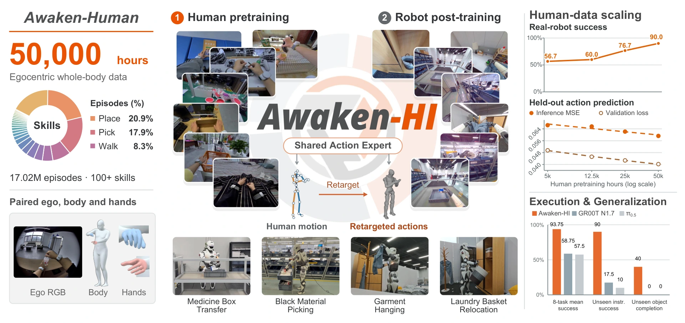
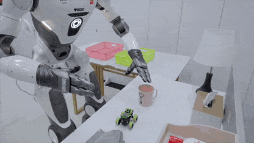
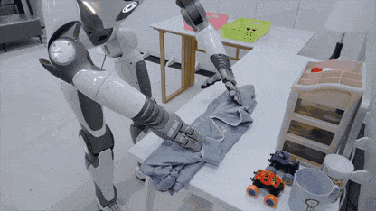
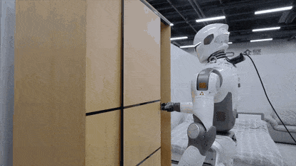
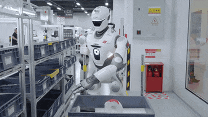
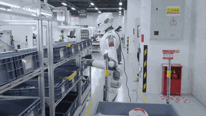
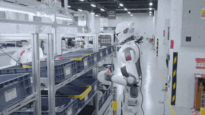
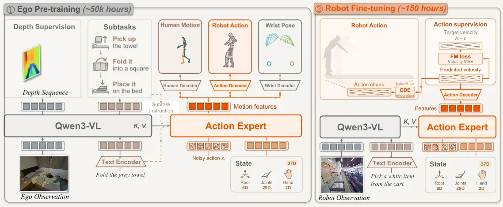

<p align="center">
  
</p>

<h3 align="center" class="project-title">
  <picture>
    <source media="(prefers-color-scheme: dark)" srcset="docs/assets/awaken-hi-title-dark.png">
    
  </picture>
</h3>

<p align="center"><strong>Scaling Humanoid Intelligence with Whole-Body Human Experience</strong></p>

<p align="center">
  <a href="https://engineai-robotics.github.io/Awaken-HI/"></a>
  <a href="https://arxiv.org/abs/2611.26420"></a>
  <a href="https://huggingface.co/datasets/EngineAI-Embodied/Awaken-Human"></a>
</p>

<p align="center">
  
</p>

## ✨ Highlights

- **Awaken-HI** is a VLA model for humanoid loco-manipulation that predicts human motion and retargeted robot actions with one action expert.
- **Awaken-Human** provides 50,000 hours of first-person stereo video aligned with full-body human motion across diverse tasks and settings.
- **Scaling and generalization.** With more human pretraining data, action prediction error fell according to an empirical scaling law and real-robot success rose. The policy handled objects unseen in robot post-training and new object–destination pairings.

## 📋 TODO

We plan to open-source resources in stages.

<p>
  ☑ <del>Technical report</del><br>
  ☑ <del>Dataset</del><br>
  ☐ Code, including inference code<br>
  ☐ Model weights<br>
  ☐ Simulation platform
</p>

## 🎬 Real-robot demos

Highlights from two continuous T800 rollouts, shown at 1.5–4× speed.

### 🏠 Household

<table align="center">
  <tr>
    <th width="33%">Bimanual sorting</th>
    <th width="33%">Garment hanging</th>
    <th width="33%">Laundry basket transfer</th>
  </tr>
  <tr>
    <td align="center"><a href="docs/assets/task-demos/t6.gif"></a></td>
    <td align="center"><a href="docs/assets/task-demos/t7.gif"></a></td>
    <td align="center"><a href="docs/assets/task-demos/t8.gif"></a></td>
  </tr>
</table>

### 🏭 Factory

<table align="center">
  <tr>
    <th width="33%">Black item pickup</th>
    <th width="33%">Middle-shelf placement</th>
    <th width="33%">Upper-shelf placement</th>
  </tr>
  <tr>
    <td align="center"><a href="docs/assets/task-demos/t2.gif"></a></td>
    <td align="center"><a href="docs/assets/task-demos/t3.gif"></a></td>
    <td align="center"><a href="docs/assets/task-demos/t5.gif"></a></td>
  </tr>
</table>

## 🧠 Method

Awaken-HI is a vision-language-action model for whole-body mobile manipulation.

<p align="center">
  
</p>

## 📊 Benchmark results

| Evaluation | π₀.₅ | GR00T N1.7 | Awaken-HI |
| :--- | ---: | ---: | ---: |
| Eight individual tasks (mean) | 57.5% | 58.75% | **93.75%** |
| Industrial stocking task | 10% | 30% | **90%** |
| Household tidying task | 20% | 10% | **80%** |
| Four unseen object–destination pairings (mean) | 10% | 17.5% | **90%** |

## 📖 Citation

```bibtex
@misc{engineai2026awakenhiscalinghumanoidintelligence,
      title={Awaken-HI: Scaling Humanoid Intelligence with Whole-Body Human Experience},
      author={EngineAI},
      year={2026},
      eprint={2611.26420},
      archivePrefix={arXiv},
      primaryClass={cs.RO},
      url={https://arxiv.org/abs/2611.26420},
}
```
